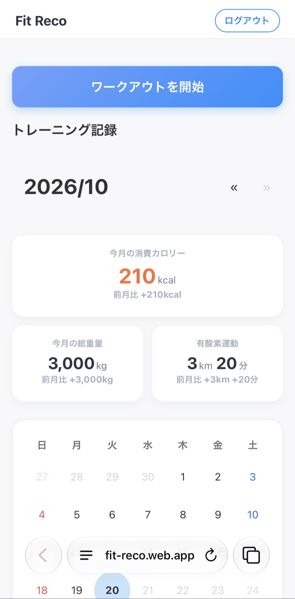
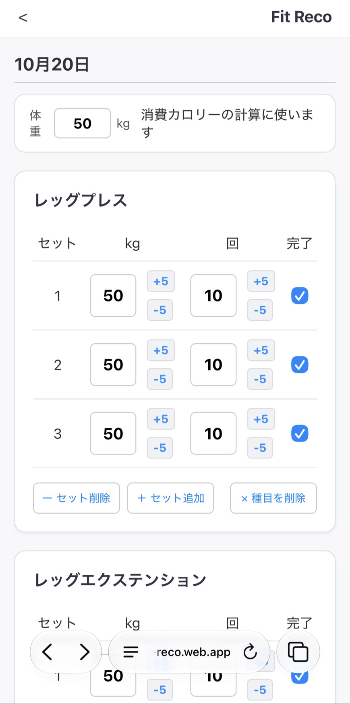
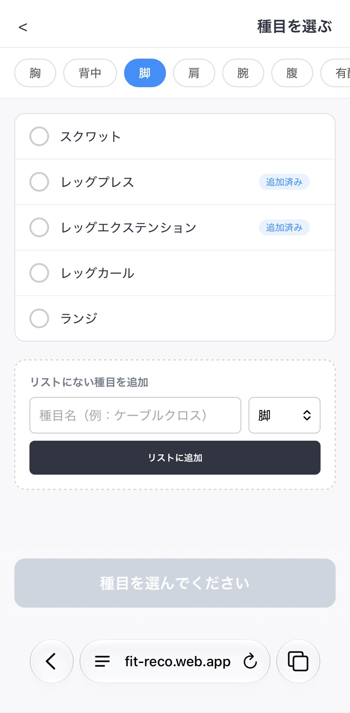

# Fit Reco

**筋トレ初心者でも迷わず記録できて、続けたくなるワークアウト記録アプリ**

🔗 **https://fit-reco.web.app**

スマホでもPCでも、ログインすれば同じ記録を見られます。登録しなくてもすぐに使い始められます。

  

## 作ったきっかけ

自分が筋トレを始めたばかりのころ、初心者向けの情報が少なく、記録をつけるたびに種目名ややり方を別のアプリで調べる手間がありました。
そこで、**初心者でも迷わず記録できること**と、**成果が目に見えて続けたくなること**を目指して作りました。

## 主な機能

### ワークアウトの記録
- 部位（胸・背中・脚・肩・腕・腹・有酸素）ごとのリストから種目を選んで追加
- 複数の種目をまとめて選んで一度に追加でき、部位タブには選んだ数、すでに今日のワークアウトにある種目には「追加済み」を表示
- 種目の横の ⓘ から、主に使う筋肉・補助で使う筋肉（大胸筋上部・中部・下部のように細かく分け、主に使う筋肉に色を付けた体の図つき。上半身だけの種目は首からお腹までを拡大）・使う器具・初心者のおすすめ重量（男性・女性）と回数・意識するポイントを確認できる（種目を選ぶ画面とワークアウト画面の両方）
- リストにない種目は自分で追加でき、次回からはリストから選べる（不要になったら×で削除。これまでの記録は消えない）
- セットごとに重量×回数（有酸素は距離×時間）を入力し、完了したセットにチェック
- `+5` / `-5` ボタンで、スマホでも片手で数値を変えられる
- 種目カードは左側の持ち手（≡）をドラッグして並び替えられる。マウスでも指でも操作でき、画面の端に近づけると自動でスクロールする
- 体重を入力しておくと、完了したセットから消費カロリーを計算
- ワークアウト完了時に、総重量・有酸素・消費カロリー・やった種目のまとめを表示

### 成果の振り返り
- カレンダーで、トレーニングした日に印がつく
- 月ごとの消費カロリー・総重量・有酸素運動の合計と、**前月比**を表示
- 日付ごとの記録カードに、その日の総重量と消費カロリーを表示
- 記録カードを開くと、その日の種目とセットの詳細が見られる
- カレンダーの日付をタップすると、その日の記録カードまで移動して開く

### アカウント・同期
- 初めて開いたときは自動でゲスト（匿名）としてログインし、登録なしで使える
- 「Googleでログイン」を押すと、それまでの記録をそのままGoogleアカウントに引き継げる
- 2台目の端末でゲストとして記録したあとにログインした場合も、その端末の記録をGoogleアカウントに合流させる（同じ日の記録がすでにあるときはアカウント側を残す）
- 記録はクラウドに保存され、スマホとPCで同期される
- 電波の届かない場所でも記録でき、つながったときに自動で保存される

## 工夫した点

**1. 初心者が迷わない入力**
種目名を自分で入力させると、初心者は名前が分からず手が止まってしまいます。そこで、部位ごとに用意したリストから選ぶ形にしました。その日にやる種目をまとめて選べるようにし、自重種目は初期重量を0kgにするなど、最初の入力の手間も減らしています。

**2. やる順番に合わせて並び替えられる**
ジムの混み具合などで、予定していた順番どおりに種目ができないことはよくあります。そこで、種目カードをドラッグで並び替えられるようにしました。Pointer Events を使ってマウスと指の操作を同じ処理で扱い、スマホでも動かしやすいようにカードの左側全体を持ち手にしています。初めての人にも分かるよう、並び替えの案内を表示し、一度使ったら出さないようにしました。

**3. 続けたくなる見せ方**
カレンダーの印と、月の総重量・前月比で「どれだけ頑張ったか」がひと目で分かるようにしました。日ごとの記録カードにも総重量と消費カロリーを出し、開かなくてもその日の成果が分かるようにしています。数字が増えていくことで、続けるモチベーションにつながるようにしています。

**4. 登録しなくても始められる**
最初にアカウント登録を求めると、使い始める前にやめてしまう人がいると考えました。そこで、最初は匿名ログインで使い始め、あとからGoogleアカウントに引き継げる「アカウントリンク」の仕組みを使っています。ユーザーIDが変わらないので、それまでの記録が消えません。
すでに別の端末でGoogleアカウントを登録済みの場合は、アカウントリンクができずエラーになります。この場合は、ゲストの記録を先に読み込んでからGoogleアカウントに切り替え、アカウントにまだない日付の記録だけを追加することで、どちらの記録も失われないようにしました。

**5. データの安全性**
記録はユーザーIDごとに保存場所を分け、Firestoreのセキュリティルールで「ログインしている本人だけが自分のデータを読み書きできる」ように制限しています。

## 消費カロリーの計算

```
消費カロリー(kcal) = METs × 体重(kg) × 時間(h) × 1.05
```

- 筋トレ：5.0 METs、1セットあたり2分（休憩込み）として計算
- 有酸素：種目ごとのMETs（ウォーキング 3.5、エアロバイク 6.8、クロストレーナー 5.0 など）。ランニングは距離と時間から速度を求め、速度に応じたMETsを使う

## 使用技術

| 分類 | 技術 |
|---|---|
| フロントエンド | HTML / CSS / JavaScript（ES Modules、フレームワークなし） |
| 認証 | Firebase Authentication（匿名認証・Googleログイン・アカウントリンク） |
| データベース | Cloud Firestore（オフライン対応のローカルキャッシュあり） |
| 公開 | Firebase Hosting |

## データ構造

```
users/{ユーザーID}
  ├─ bodyWeight          体重
  ├─ customExercises     自分で追加した種目
  └─ logs/{日付}         その日のワークアウト記録
       ├─ totalWeight    総重量
       ├─ distance       有酸素の距離
       ├─ minutes        有酸素の時間
       ├─ calories       消費カロリー
       └─ exercises      種目とセットの詳細
```

セキュリティルール：

```
match /users/{userId}/{document=**} {
  allow read, write: if request.auth != null && request.auth.uid == userId;
}
```

## ファイル構成

```
├── index.html       ホーム（カレンダー・月の成果・記録カード）
├── script.js
├── style.css
├── workout.html     ワークアウト記録画面（種目カードの並び替え・完了時のまとめ）
├── workout.js
├── workout.css
├── exercises.html   種目選択画面（複数選択・自分で種目を追加）
├── exercises.js
├── exercises.css
├── firebase.js      Firebaseの設定とデータの読み書き（ログイン・記録の引き継ぎ）
├── firebase.json    Firebase Hostingの設定
├── 404.html         ページが見つからないときの画面
└── images/          README用のスクリーンショット
```

## ローカルで動かす方法

ES Modules を使っているため、HTMLファイルを直接開くのではなく、ローカルサーバー経由で開く必要があります。

```bash
git clone https://github.com/rararav0211-cloud/Fit-Reco.git
cd Fit-Reco
python3 -m http.server 8000
```

ブラウザで http://localhost:8000 を開きます。

## 今後やりたいこと

- 種目ごとの説明（初心者のおすすめ重量・回数、意識するポイント）
- 体重の記録とグラフ表示
- PWA化（スマホのホーム画面に追加してアプリのように使える）
